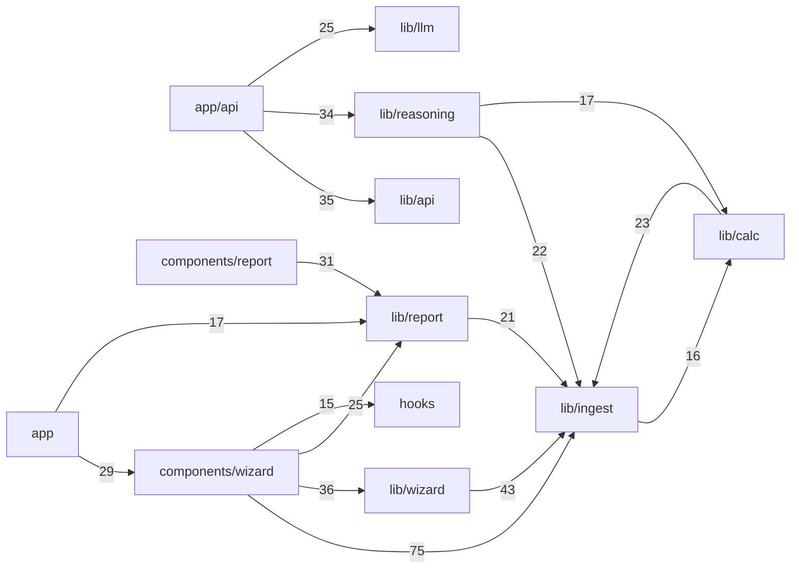

# FlawCheck · NDT Inspection Copilot

FlawCheck turns ultrasonic thickness data and PT/MT notes into a deterministic NDT examination report. TypeScript computes every engineering value and verdict; NVIDIA Nemotron 3.5 Super VL on Nebius Token Factory writes the narrative around those numbers when a runtime key is supplied.

Built for the [Nebius x NVIDIA Global AI Hackathon](https://devpost.com/hackathons), Best Apps and Agents track.

   

> **The invariant:** TypeScript computes every engineering number and verdict. The model never touches arithmetic. Each verdict is deterministic, each citation is renderer-locked, and each report is stamped as an engineering aid rather than a certification or a final approval.

## What it does

| # | Stage | What happens |
|---|---|---|
| 1 | Ingest | Upload an ultrasonic thickness CSV, or load the bundled Zenodo sample |
| 2 | Review | Confirm column mapping, component metadata and PT/MT notes |
| 3 | Evaluate | Pure TypeScript computes t-required, corrosion rates, remaining life and FAIL / RE-CHECK / ACCEPT against ASME B31.3, API 570 and API 574 |
| 4 | Reason | Nemotron 3.5 Super VL streams a clause-cited narrative around the precomputed values; every citation resolves through a renderer-locked allowlist |
| 5 | Report | Download a PDF and a canonical CSV, with the audit trail, inspector sign-off, SHA-256 register seal and limitations notice |

Reasoning panes load when you open them. If extraction is still running, the app shows a waiting message instead of sending the request, and the narrative starts automatically once extraction finishes. Panes that already loaded stay cached, closing a row never starts a new request, and returning from the report keeps the extracted context and the narratives already loaded.

## Run it locally

You need Node.js 24 or newer. A Nebius key is optional; without one the app runs in deterministic fallback.

```bash
git clone https://github.com/ahmed13576/flawcheck.git
cd flawcheck
npm install
cp .env.example .env.local   # set NEBIUS_API_KEY for live inference
npm run dev                  # http://localhost:3000
```

On the landing page, **Explore a sample inspection** runs a one-click demo over 420 readings from the WBT-S6 tank section. **Load full register (scale demo)** runs the complete 4,912-reading register.

## How it is built

```
Parse → Calculate → Narrate → Render

  lib/ingest/     CSV parser, column mapping, validation, grouping
  lib/calc/       Pure TypeScript calc engine (t-min, corrosion, RL, verdicts)
  lib/reasoning/  Citation tokenizer, deterministic fallback, 4 server lints
  lib/llm/        Nebius Token Factory client (json_object → Zod → 1 retry)
  lib/report/     Snapshot, PDF schema, audit trail, canonical CSV
  app/api/        SSE streaming routes (extraction, narrative, PDF, CSV)
```

Analytics has one geometry engine and two renderers. `lib/analytics/` does the heatmap binning, trend regression and gauge maths in pure TypeScript, with no React and no arithmetic outside `lib/calc`. `components/analytics/` draws it as live SVG on the results screen, and `components/report/pdf-trend-curve.tsx` plus `pdf-heatmap.tsx` draw the same geometry as vector PDF.

### Dependency graph



## Models and providers

| Role | Model | Usage |
|---|---|---|
| Acceptance narrative | `nvidia/Nemotron-3.5-Super-VL` | Streaming SSE, `reasoning_effort: low` |
| Extraction and structuring | `nvidia/Nemotron-3.5-Super-VL` | Batched, `json_object` mode |
| Deterministic fallback | none, pure TypeScript | Always available, no network, no cost |

Model IDs come from the environment and are validated at startup against the live `/v1/models` catalog.

## Tavily code-edition lookup

After an evaluation, the report screen asks Tavily once for code-edition and errata sources relevant to the design code. Results are cached per evaluation and time out after three seconds. A missing key, a timeout or a failed request returns no links, and the report still renders.

## Tests and gates

| Gate | Command | Result |
|---|---|---|
| Unit and integration | `npm test` | 743 passed, 5 skipped (hermetic, no network, key-independent) |
| Strict TypeScript | `npm run typecheck` | clean |
| Lint | `npm run lint` | 0 errors |
| Production build | `npm run build` | 11 routes |
| Report artifacts | `npm run generate:wbt-s6-report` then `python scripts/verify_pdf.py` | 3 pages, seal matches the canonical CSV |

Live model tests sit behind a gate and need a key:

```bash
FLAWCHECK_LIVE_LLM=1 npm test
```

## Deploy

The app is a stock Next.js 16 project with Node-runtime API routes, SSE streaming and server-side react-pdf, so Netlify's Next.js runtime deploys it without changes.

1. Push the repo to GitHub and import it in Netlify. Build command is `npm run build`.
2. Set environment variables under **Site configuration → Environment variables**.

| Variable | Required | Value |
|---|---|---|
| `NEBIUS_API_KEY` | no | your Token Factory key, only for live Nemotron inference |
| `NEBIUS_BASE_URL` | no | defaults to `https://api.tokenfactory.nebius.com/v1/` |
| `NEBIUS_MODEL_REASONING` | no | defaults to `nvidia/Nemotron-3.5-Super-VL` |
| `NEBIUS_MODEL_EXTRACTION` | no | defaults to `nvidia/Nemotron-3.5-Super-VL` |
| `TAVILY_API_KEY` | no | enables the code-edition lookup |
| `FLAWCHECK_DISABLE_LLM` | no | `1` forces deterministic fallback with zero model calls |

Without a Nebius key the app still runs end to end. Every evaluation falls back to the deterministic engine, and the UI labels it as fallback.

## Dataset

The demo uses [Zenodo record 16780668](https://zenodo.org/records/16780668) (CC BY 4.0): real ultrasonic thickness readings from ballast tank locations over 11 annual survey campaigns.

| Demo | Data |
|---|---|
| Explore a sample inspection | WBT-S6 tank subset: 420 readings, 40 CMLs (A1 to D10), every CML multi-campaign. Stored at `lib/demo/fixtures/zenodo-16780668-ut-register-subset.json` and mirrored as `public/sample-ut-register-subset.csv` |
| Load full register | The untouched register: 4,912 readings across 12 tank locations, at `lib/demo/fixtures/zenodo-16780668-ut-register.json` |

<details>
<summary>How the subset is generated</summary>

The subset is derived from the full register by tank-identity filtering only. It is never date-filtered, so per-CML campaign history stays intact.

```bash
node scripts/generate-demo-subset.mjs
```

Source attribution and the licence terms are in `lib/demo/ATTRIBUTION.md`.
</details>

### What the WBT-S6 fixture pins

The fixture is treated as one component with exactly 420 historical readings and 40 unique CMLs. The CML summary layer exposes scan count, baseline, previous, latest and historical-minimum thickness, pressure and structural required thickness, validated short- and long-term rates, governing rate, remaining life, flags, disposition and source traceability. Tests pin the 19.85 mm required thickness, the 19.95 mm inclusive RE-CHECK ceiling, one register row per CML, and the four-level Top-10 ordering.

## Limits

FlawCheck is an NDT examination and reporting aid. It does not claim professional engineering certification, guaranteed code compliance, inspector replacement, PDF/UA conformance, API 570 interval approval, Fitness-for-Service approval or final continued-service authorization. NDT examination, API inspection and engineering or FFS decisions remain separate responsible roles. Confirm findings, calculations and disposition through the responsible inspector and the applicable procedures.

## License

[MIT](LICENSE).
