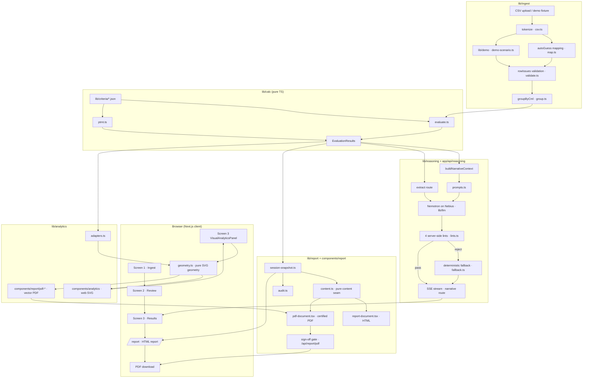

# FlawCheck — Architecture

FlawCheck is an NDT inspection copilot: it turns raw ultrasonic-thickness CSVs and PT/MT surface-inspection notes into code-compliant, clause-cited evaluation results and certified inspection reports. The product is a Next.js 16 app (MIT, open source) that runs evaluation entirely in deterministic TypeScript and uses an LLM (NVIDIA Nemotron on Nebius Token Factory) only to structure and narrate around precomputed values.

This document describes the system as it exists in the repository. Every path is relative to the repository root.

---

## 1. High-level data flow

```
 ┌────────────┐   ┌─────────────┐   ┌──────────────┐   ┌─────────────┐   ┌──────────────┐
 │  CSV file  │──▶│ lib/ingest  │──▶│  lib/calc    │──▶│ lib/reasoning│──▶│  lib/report  │
 │  (upload)  │   │ parse · map │   │  (pure TS)   │   │ (LLM + lints)│   │ HTML / PDF    │
 └────────────┘   │ validate ·  │   └──────────────┘   └─────────────┘   └──────────────┘
                  │ group       │        │  criteria            │  lints            │
                  └─────────────┘        ▼  (single source      ▼  (server-side)    ▼
                  lib/demo (fixtures)    lib/criteria/*.json    app/api/reasoning/  app/api/report/pdf/
```

The pipeline is `Parse → Calculate → Narrate → Render`:

1. **Ingest** — tokenize and validate the CSV, auto-map columns, group readings into CML campaign histories (`lib/ingest/`).
2. **Evaluate** — a pure TypeScript engine computes t-required, corrosion rates, remaining life, inspection intervals, and verdicts against ASME B31.3 / API 570 / API 574 criteria loaded from `lib/criteria/*.json` (`lib/calc/`). **The LLM never touches arithmetic.**
3. **Reason** — the LLM streams a clause-cited acceptance narrative around the precomputed values; four server-side lints police every number, verdict, citation, and verbatim quote, with a deterministic fallback narrative always ready (`lib/reasoning/`, `app/api/reasoning/`).
4. **Render** — an HTML report screen and a server-rendered certified PDF share one pure content seam (`lib/report/`, `components/report/`).

---

## 2. Ingestion pipeline — `lib/ingest/`

The ingestion layer is a strict, defensive CSV-to-session pipeline. All modules are pure where possible; state lives in the wizard reducer (Section 7).

| Module | Role |
|---|---|
| `csv.ts` | RFC 4180 quote-aware tokenizer, delimiter sniffing (`,` / `;` / `\t`), BOM strip, doubled-quote escapes, CRLF/LF/CR separators. Skips only *true* blank lines; keeps `,,` records as data. Cells are built as **null-prototype objects** (`buildCells`) so attacker-controlled header text can never pollute `Object.prototype` (T-02-02). |
| `map.ts` | Header normalization (`normalizeHeader` strips non-alphanumerics) and auto-guess against the UI-SPEC alias table. A claimed header is removed from the pool (IN-04: `CML` aliases both Reading ID and Tank/Location). CSV thickness-unit auto-guess from the header's last token (`csvThicknessUnitFromHeader`: `_mm` / `_in` / `_mils`, default mm). CR-02: nominal-scantling headers (`Original_Scantling_mm`, …) are excluded from auto-guess — they are constants, not measured history; an explicit mapping is honored but warns. |
| `validate.ts` | Row validation with a strict numeric grammar (`parseNumericCell` — never bare `Number()`, which accepts `''`, `0x1A`, `Infinity`). Two numbering spaces: parse errors carry physical file `line`; semantic row issues carry 1-based data-row index. Catalog: missing value / not a number / impossible value (≤ 0 or ≥ OD) / invalid date = **error**; future date, duplicate reading ID, scantling-as-history = **warning**. Errors block Run Evaluation; warnings never do. Hard limits: `MAX_ROWS = 50_000`, `MAX_FILE_BYTES = 25 MB`. Zod at every parse boundary. |
| `group.ts` | The ingest→calc seam. Groups valid rows by CML identity (mapped Tank + grid-position column when present; Reading_ID fallback), sorts each group by date, and derives `t_initial` (first campaign reading), `t_previous` (previous campaign), and `dtLt/dtSt` years (UTC day gap / 365.25). Wide-format mapped `t_initial`/`t_previous` columns take precedence over derived history. **Units are canonicalized to mm here** (`toMm`) — the engine consumes mm only. Unmapped Tank ⇒ each row is its own CML with null history (verdicts still compute, CR-degradation policy). |
| `session.ts` | The single JSON-serializable data model: `EvaluSession`, `EvaluationInput` (the group→evaluate seam type), `EvaluationResults`, `ReadingResult`, `PtmIndicationResult`, `ComponentMetadata`, verdict/unit/flag types. `assertUnitsDeclared` is the engine-side gate: evaluation is refused until both CSV and metadata units are declared (ING-05), with the verbatim UI-SPEC error copy. |

**CSV mapping preview** — after parse, the user reviews the auto-guessed column mapping (`components/wizard/column-mapping-panel.tsx`) and the parsed-row table (`parsed-row-table.tsx`); every dropdown stays overridable (UI-07). Metadata and PT/MT notes are entered on Screen 2 (`metadata-form.tsx`, `ptmt-entry.tsx`).

**Demo fixtures — `lib/demo/`**

- `demo-scenario.ts` builds a complete demo `EvaluationSession` from committed Zenodo data (real UT readings, CC BY 4.0; see `ATTRIBUTION.md`). The explicit mapping deliberately leaves `t_initial`/`t_previous` unmapped so history is derived from real campaign spread. Preset metadata: OD 2000 mm, t-nominal 20 mm, t-structural 19.85 mm (governs; pressure branch negligible at 0.05 MPa), gauge uncertainty 0.1 mm, piping Class 2.
- Fixtures (committed JSON, also mirrored as CSVs in `public/`):
  - `fixtures/zenodo-16780668-ut-register-subset.json` — **420 rows**, the WBT-S6 tank subset (one tank, every CML multi-campaign). This is the **primary demo** ("Explore a sample inspection"). Generated deterministically by tank-identity filtering only (`scripts/generate-demo-subset.mjs`).
  - `fixtures/zenodo-16780668-ut-register.json` — **4,912 rows**, the untouched full register across 12 tank locations. This is the **scale demo** ("Load full register (scale demo)").
  - Both scopes flow through the identical `buildCells` → `ParsedRow` parse path — no special-casing (T-06-02-01); the reducer carries the scope as `ui.demoScope`.

---

## 3. Deterministic calc engine — `lib/calc/` + `lib/criteria/`

### 3.1 Invariant and boundaries

`lib/calc` is the **deterministic ground truth**. Files under it must never import from the LLM layer, React, `next`, or Node builtins — enforced by an eslint `no-restricted-imports` block and a vitest boundary guard. `lib/calc/index.ts` is the public barrel — the app layer imports only from it. Every threshold, coefficient, and citation id loads from `lib/criteria/*.json` via `lib/calc/criteria.ts`; formulas are implemented as *shapes* in TypeScript, never as hard-coded constants.

### 3.2 Criteria — single source of truth (`lib/criteria/`)

| File | Content |
|---|---|
| `ut-criteria.json` | Unit system (canonical mm/years), governing-t-required rule (`t_required = max(t_pressure, t_structural)` — API 574 §10.5.1.4), B31.3 Eq. 3a and Barlow formula definitions, API 570 corrosion-rate formulas (7.1.2), remaining-life formula (7.2), negative-CR policy, half-life inspection-interval rule (6.3.3) + API 570 Table 1 class maxima (Class 1 = 5, Class 2 = 10, Class 3 = 10, Class 4 = "optional"), verdict bands with locked boundary conventions and default gauge uncertainty 0.1 mm. |
| `ptmt-criteria.json` | ASME B31.3 surface acceptance: relevance threshold 1.5 mm, morphology definitions (linear = L > 3W), rounded limit 5.0 mm, aligned-cluster rule (count ≥ 4 within 1.5 mm edge-to-edge), escalation rules, clause map (MT → 344.3.2, PT → 344.4.2). |
| `citations.json` | The **verified allowlist** — 15 records, each with `id`, `code`, `edition`, `clause`, `title`, `scope_note`, `verified` date, source PDF, and page. This is the only source of citation text anywhere in the app. |

### 3.3 Engine modules

| Module | Computes |
|---|---|
| `formulas.ts` | `requiredThickness`: B31.3 Eq. 3a `t = (P·OD)/(2(S·E·W + P·Y)) + FCA` or in-service Barlow `t = (P·OD)/(2·S·E) + FCA`; then **`t_required = max(t_pressure, t_structural)`** (API 574 §10.5.1.4), rounded to 6 dp at the exit. Emits the governing-branch citations. |
| `corrosion.ts` | CR_LT and CR_ST per API 570 §7.1.2 (`(t_initial − t_actual)/Δt`, `(t_previous − t_actual)/Δt`, 6 dp). `rateOutcome` surfaces both raw rates verbatim, computes `governing = max(LT, ST)`, **floors the governing rate at 0** for RL (negative-CR policy), and flags `insufficient_history` (null/zero governing) and `measurement_inconsistency` (either raw rate negative). |
| `remaining-life.ts` | RL = `(t_actual − t_required)/CR_governing` per API 570 §7.2, 4 dp. Returns `null` on zero/null governing rate — **never Infinity** — and clamps to `0` when `t_actual ≤ t_required` (retirement). |
| `interval.ts` | API 570 §6.3.3 half-life rule: `interval = min(RL/2, classMax)`; if `RL < 4 yr` then `min(RL, 2.0)`. Class maxima load from the JSON via `criteria.ts` (an unknown class refuses loudly — never an uncapped interval). RL ≤ 0 with a valid positive CR returns state `immediate-inspection` (G14: distinct from insufficient-history; never a negative interval or past date). |
| `verdicts.ts` | The locked band order from the criteria JSON, verbatim: `if (t_actual < t_required) reject; else if (t_actual < t_required + gauge_uncertainty) re_check; else accept`. Boundary conventions locked: equality with t-required ⇒ re_check (reject is strictly less-than); equality with t-required + uncertainty ⇒ accept. Both sides canonicalized to 6 dp before comparing. |
| `outliers.ts` | Modified z-score (median/MAD, Iglewicz–Hoaglin) per CML population; threshold `3.5`; populations < 4 readings or MAD 0 never flag. Outliers **warn only** — they never override verdict banding (UI-18). |
| `ptmt.ts` | PT/MT indication triage per `ptmt-criteria.json`: relevance (strict `>`), linear (strict `L > 3W`), aligned cluster (count and separation with strict `≤`), oversized rounded (strict `>`). Crack-suspect non-relevant maps to re_check (the only inferred mapping). |
| `dates.ts` | Strict-ISO parse (never `new Date(string)` — rejects `2026-02-31`), UTC day math, `Δt = days/365.25` (pinned by G13), `addYearsUtc` with Feb-29→Feb-28 clamp; the engine anchors next-inspection to the measurement date — never `Date.now`. |
| `units.ts` | `toMm` — exact literals (1 in = 25.4 mm, 1 mil = 0.0254 mm). Unit definitions, not criteria values. |
| `round.ts` | The single float-safety primitive, `roundTo`: canonical rounding at public-function exits (t-required/CR 6 dp, RL 4 dp, interval 2 dp, modified z 4 dp). |
| `evaluate.ts` | Orchestration: fail-closed non-finite guards on every input and on computed t-required (WR-01), per-reading compute pipeline, per-CML outlier pass, summary rollup (distinct mapped-Tank locations), and `citationsUsed` aggregation. |

### 3.4 Verdict model

- Band names: `accept` / `re_check` / `reject`; the UI renders ACCEPT / RE-CHECK / FAIL (rendering concern only).
- Reading flags: `outlier`, `measurement_inconsistency`, `insufficient_history`, `immediate_inspection`.
- Result fields contract: `rlYears` and rates are **null, never NaN/Infinity**; `nextInspection` is null for immediate-inspection and insufficient-history readings.

---

## 4. Reasoning layer — `lib/reasoning/` + `app/api/reasoning/`

The LLM **explains, never calculates**. It receives precomputed values and may only restate them under strict server-side linting; on any violation the deterministic fallback is served instead.

### 4.1 Model routing — `lib/llm/`

- `config.ts` — env-only routing. `NEBIUS_MODEL_REASONING` and `NEBIUS_MODEL_EXTRACTION` are required env vars (both currently `nvidia/nemotron-3-super-120b-a12b`); `NEBIUS_BASE_URL` defaults to the Nebius Token Factory endpoint. **No model-ID literals in code.**
- `client.ts` — the single server-side seam for the API key.
- `complete.ts` — `runValidatedCompletion`: `json_object` response format → Zod schema validation → exactly one bounded retry (the model sees its own bad reply) → tolerant JSON extraction (balanced-brace scan, last-first for CoT). Optional usage sink, abort/timeout signal propagation.
- `validate-config.ts` — startup/health validation of configured model IDs against the live `/v1/models` catalog (exact string match), cached on `globalThis`, never crashes startup. Exposed via `GET /api/health`.
- `schemas.ts` — `isLlmDisabled()`: the kill-switch `FLAWCHECK_DISABLE_LLM=1|true` **or** no `NEBIUS_API_KEY`.

### 4.2 Context construction — `narrative-context.ts`

`buildNarrativeContext` returns **`{ payload, allowedNumbers, allowedCitationIds }` together** so the prompt's numeric surface and the lint allowlists can never drift. Numeric-surface discipline:

- The payload carries only precomputed values at table precision (thickness 2 dp, rates 3 dp, years 1 dp).
- **No identifiers are injected** (reading ids, CML tags, dates, clause numbers, code names) — any of them would trip the numeric lint the moment the model quotes them.
- PT/MT thresholds are injected deliberately (repo-vetted criteria values) so legitimate limit-mentioning passes.
- `numericAllowlist` policy (A6): raw 6-dp value plus its 1/2/3-dp display variants for every injected number.

### 4.3 Prompts — `prompts.ts`

- `NARRATIVE_SYSTEM_PROMPT` — five rules: numbers only verbatim from PRECOMPUTED VALUES; chain order (measured inputs → governing clause (cite) → limit → verdict); cite-only grammar `[[cite:<id>]]` with paraphrase (never quote); exactly one final line `Verdict: ACCEPT.|RE-CHECK.|FAIL.`; 120–180 words, plain prose.
- `buildNarrativeUserPrompt` — assembles VERDICT + payload + ALLOWED CITATIONS (from `citations.json` records) + the output contract.
- Extraction prompts — `EXTRACTION_SYSTEM_PROMPT` frames untrusted inspector notes/indication text behind `BEGIN-NOTES/END-NOTES` and `BEGIN-INDICATIONS/END-INDICATIONS` delimiters as **data, not instructions** (prompt-injection mitigation, T-03-04); schema caps bound the blast radius; `notableFacts`/`points` are digit-free by contract.

### 4.4 Server-side lints — `lints.ts` (pure, zero imports)

1. **numericConsistency** — after stripping `[[cite:…]]` tokens and designator strings, every numeric literal in the text must be a member of the allowed set.
2. **verdictAgreement** — exactly one `Verdict:` line ending in the verdict contract, matching the engine verdict's label byte-for-byte.
3. **citationAllowlistLint** — every `[[cite:<id>]]` must be in the engine-emitted subset for this reading; malformed traits (wrong charset, empty) reject too (WR-05) — citation machinery must never reach the reader.
4. **verbatimNgramLint** — any 8-word window overlapping the `citations.json` corpus (title + scope_note) rejects (cite-don't-quote).

`runFinalLints` runs all four in order; the first failure names its reason. `sentenceRelayCutoff` provides the exact-byte completed-sentence prefix for mid-stream guarding.

### 4.5 Deterministic fallback — `fallback.ts`

Pure, zero-LLM narratives that restate the engine's inputs → clause → limit → verdict as cited prose. `cite()` emits `[[cite:<id>]]` **only** when the engine emitted that id for this reading; every number passes through `formatFixed` at table precision; the gauge-uncertainty band restates the locked comparison order from `verdicts.ts` (never re-derives); every narrative closes with `Verdict: {label}. All verdicts are computed in code and unaffected.` Labels are byte-identical to the `VerdictChip` mapping (pinned by tests).

### 4.6 API routes

**`POST /api/reasoning/extract`** (batched, `json_object` mode)
- Accepts metadata + notes + indications + client-computed population digest; validates with strict Zod (400 on malformed/unknown fields).
- `isLlmDisabled()` ⇒ `200 { extraction: null, usage: null, disabled: true }` (no extraction needed in fallback mode).
- One Super-120B call via `runValidatedCompletion` (max 3000 completion tokens, `reasoning_effort: low`, 60 s timeout + client-disconnect abort). Returns `{ extraction, usage }` with real token/latency/model telemetry; 502 naming the error after the bounded retry exhausts — never a partial extraction.

**`POST /api/reasoning/narrative`** (SSE stream)
- Frame protocol (typed in `schemas.ts`): `meta` / `delta` / `usage` / `rejected` / `fallback` / `error` / `[DONE]`.
- Route selection:
  - LLM disabled ⇒ `fallback` frame (`reason: llm_disabled`) + `[DONE]`.
  - Enabled + `kind: cml` + null extraction ⇒ **422** (narration without the context pack is garbage-in, SC1).
  - Enabled ⇒ Super-120B upstream stream (`max_completion_tokens: 4000`, `reasoning_effort: low`, `include_usage`, 30 s timeout), relayed through the **sentence-level numeric guard**: the completed-sentence prefix is linted before relay (byte-exact), the trailing fragment is buffered until stream end.
  - At stream end, `runFinalLints` decides: pass ⇒ `delta` tail + `usage` frame (real tokens/latency/model); fail ⇒ `rejected` frame with reason and the deterministic fallback text, which the client swaps in — **a rejected narrative never carries usage metrics**.
- Both routes share the per-IP fixed-window rate limiter (20 req/min, `lib/api/rate-limit.ts`).

### 4.7 Client-side streaming

`hooks/use-narrative-stream.ts` — a framework-free narrative store (cache keyed by `evaluatedAt::kind::id`, one AbortController per key, FIFO cap of 3 concurrent fetches, frame-driven state transitions). `UI-41` client gate: narration is not attempted when extraction is unavailable.

---

## 5. Report generation — `lib/report/` + `components/report/`

The report layer is a **pure content seam shared by two renderers**: the on-screen HTML report and the server-rendered certified PDF. One source of truth ⇒ the two outputs cannot drift.

### 5.1 Content seam — `lib/report/content.ts` (server-safe, no `"use client"`)

- `citationRef(id)` — composes the reference string **only** from the `citations.json` record fields (`code §clause`); an unknown id renders zero glyphs. This is the renderer-locked allowlist invariant.
- `buildFindingsBrief` — the deterministic, **non-LLM** plain-English brief (disposition sentence, next action, narrative, worst locations) over `evaluate()` output. Worst-list ordering locked: immediate_inspection first, then rejects before re-checks, then `rlYears` ascending with null RL last; capped at 5; ≤ 3 fails name locations inline.
- `buildCodeBreakdown` — verdict counts plus pressure/structural pass-fail counts comparing already-emitted fields at the 6-dp convention (no new math enters `lib/calc`).
- `VERDICT_GLOSSARY` + `VERDICT_GLOSSARY_ORDER` — one glossary consumed by Screen 3, HTML conclusions, and the PDF page-1 footer; sub-lines render only via `citationRef`.
- `buildConclusions`, `earliestNextInspection`, unit-assumption copy, disposition banner, what-to-do-next, and CSV-pointer lines — all pure compositions of emitted fields.

### 5.2 Snapshot and audit

- `session-snapshot.ts` — session-only serialization under `sessionStorage` key `flawcheck:report-snapshot:v1` (browser-local trust boundary, T-03-20). `ReportSnapshot` carries evaluatedAt, source, units, metadata, summary, readings, indications, notes, and optional `signOff` (name, certification, date, signature — all four required). Defensive parse degrades corrupt payloads to null; `withSignOff` is a pure read-modify-write helper.
- `audit.ts` — audit telemetry under `flawcheck:report-audit:v1`: exactly two steps (extraction, narrative) with **runtime-resolved** model/token/latency — never fabricated; null fields render em-dashes. `computeInputHash` fingerprints rows + mapping + units as a SHA-256 hex digest (audit-stamped reports).
- `snapshot-schema.ts` — the WR-10 strict Zod contract for the PDF ` body (every field finite-checked, strict objects reject unknown keys).

### 5.3 Renderers

- `components/report/report-document.tsx` — the on-screen HTML report (`"use client"`), used by `app/report/page.tsx`.
- `components/report/pdf-document.tsx` — the **server** PDF renderer (`@react-pdf/renderer`, no `"use client"`, `renderToBuffer`). Two `<Page>` elements:
  - **Page 1 — executive dashboard**: disposition banner, summary card, code-breakdown stats, top-10 worst locations (severity-sorted: immediate → reject → re-check → RL ascending), spatial severity heatmap, what-to-do-next, CSV pointer, verdict-glossary footer, input hash.
  - **Page 2+ — detail register**: the per-reading register with the governing-CML degradation projection (vector trend curve), notes, sign-off block, audit appendix, and disclaimers.
  - Built-in Helvetica/Courier only (no font registration), selectable text; page numbering footer.
- `components/report/pdf-trend-curve.tsx` + `pdf-heatmap.tsx` — vector-PDF counterparts (see Section 6) consuming the identical geometry engine.

### 5.4 API route — `POST /api/report/pdf`

25 MB body cap; strict WR-10 schema validation (400 on violations, never 500 for bad input); **sign-off gate** — the report is refused without all four complete sign-off fields; `renderToBuffer(buildPdfDocument(snapshot, audit))`; `Content-Disposition: attachment` with a sanitized filename. Rate-limited like the other write routes. `maxDuration = 60`.

---

## 6. Visual analytics (recent addition) — `lib/analytics/` + `components/analytics/`

A dual-renderer analytics layer: **one pure geometry engine computes every metric once**, and two independent renderers present it — interactive web SVG and vector PDF.

| Layer | Files | Notes |
|---|---|---|
| Geometry engine | `lib/analytics/geometry.ts` | Pure TypeScript, zero DOM, zero external chart dependencies. Projects **precomputed** `evaluate()` outputs only — no engineering arithmetic. Never emits NaN/Infinity; clamps all geometry into the scale domain. `calcTrendCurveGeometry` (history polyline, 10-year degradation projection, t-required intercept date, dashed anomaly stub for negative CR, ±gauge-uncertainty envelope, axis ticks); `calcCmlHeatmapGeometry` (uniform square cells, verdict colors accept `#16a34a` / re_check `#d97706` / reject `#dc2626`, cells shrink for dense registers); `calcGaugeGeometry` (arc fill clamped to [0, 100], color carries sign: ≥ 20% green, 0–20% amber, < 0% red). |
| Adapters | `lib/analytics/adapters.ts` | Grouping/selection/mapping only — every thickness, t-required, rate, and verdict flows through verbatim from engine output. `buildGoverningTrendPoints` (worst latest verdict, ties by lowest safety margin), `buildLatestPerCml` (row-major grid), `severityRank`, `cmlIdentity`. |
| Web SVG | `components/analytics/trend-curve.tsx`, `cml-heatmap.tsx`, `metric-gauge.tsx` | Interactive components rendered in the Screen 3 **VisualInspectionAnalytics** panel (`components/wizard/screen-results.tsx`). The heatmap's selected CML is relayed into the results table's row-highlight hook (`selectedCmlId` ↔ `onSelectCml`, `ROW_HIGHLIGHTED_TESTID`). |
| PDF vector | `components/report/pdf-trend-curve.tsx`, `pdf-heatmap.tsx` | `@react-pdf/renderer` `Svg/Path/Line/Circle/Rect/G/Text` primitives consuming the identical geometry engine — zero raster, crisp at any zoom. Embeds on PDF page 1 (heatmap) and page 2 (trend curve). |

---

## 7. Wizard state — `components/wizard/` + `lib/wizard/reducer.ts`

The UI is a three-screen wizard (1 Ingest → 2 Review → 3 Results) driven by a single pure reducer.

- `lib/wizard/reducer.ts` — `WizardState = EvaluationSession + ui` (screen, parsing, rowIssues, metadataDraft, evaluating, evaluatedAt, demoScope, …). Exports:
  - `createInitialState()` / `createInitialSession()` — blank session with the tracer metadata preset.
  - `WizardAction` union — ingest, mapping, metadata, PT/MT, run-evaluation, and `restore-session` actions. `restore-session` returns the saved state verbatim and is applied **post-hydration** so server and first client render byte-match.
  - `loadSample()` / `loadDemo()` (subset default, 420 rows) / `loadDemoFull()` (4,912 rows) — the demo paths.
  - `validateSession` (re-runs `rowIssues` with canonical-mm OD comparison), `metadataProblems`, `metadataFromDraft`, `blockingChecks`, `REQUIRED_FIELDS`.
- `lib/wizard/format.ts` — locked display precision (thickness 2 dp, rates 3 dp, years 1 dp), `—` for null/non-finite, `nextInspectionCell` / `rlCell` models (immediate vs dated vs dash), `formatFlagLabel`.
- `components/wizard/` — `wizard-context.tsx` (provider), `screen-ingest.tsx`, `screen-review.tsx`, `screen-results.tsx`, `results-table.tsx` (paginated 50, tab + search filter, heatmap row-highlight), `reasoning-pane.tsx`, `reasoning-context.tsx`, `pipeline-status-bar.tsx`, `metadata-form.tsx`, `ptmt-entry.tsx`, `ptmt-triage-list.tsx`, `column-mapping-panel.tsx`, `parsed-row-table.tsx`, `verdict-chip.tsx`, `citation-chip.tsx`, `findings-brief.tsx`, plus chrome (step indicator, summary strip, dropzone, confirm dialog, demo banner, flag UI).
- `app/page.tsx` — wizard root: demo provenance banner, auto-writes the report snapshot to sessionStorage whenever results exist (so `/report` is reviewable by direct URL), focus management, and screen fallback safety.

---

## 8. Deployment — Netlify

The app is a stock Next.js 16 project (Node-runtime API routes, SSE streaming, server-side react-pdf). It deploys unchanged on Netlify via the official Next.js runtime: import the GitHub repo, build command `npm run build`, environment variables set in Site configuration. There is no `netlify.toml`; Netlify auto-detects Next. Static assets live in `public/` (including mirrored demo CSVs); API routes run as serverless functions.

Environment contract (`.env.example` is the committed template):

| Variable | Required | Notes |
|---|---|---|
| `NEBIUS_API_KEY` | yes | Nebius Token Factory key; absent ⇒ `isLlmDisabled()` fallback mode (app still runs end-to-end) |
| `NEBIUS_BASE_URL` | no | defaults to `https://api.tokenfactory.nebius.com/v1/` |
| `NEBIUS_MODEL_REASONING` | yes* | currently `nvidia/nemotron-3-super-120b-a12b` |
| `NEBIUS_MODEL_EXTRACTION` | yes* | currently `nvidia/nemotron-3-super-120b-a12b` |
| `FLAWCHECK_DISABLE_LLM` | no | `1`/`true` = deterministic fallback mode, zero LLM calls |
| `TAVILY_API_KEY` | no | optional code-edition lookup; absent degrades silently |

\* The accessors require the variables when the LLM path is used; `.env.example` documents the current recommended IDs. Model IDs are validated at startup against the live catalog (`/api/health`).

Other API routes: `GET /api/health` (model-config validation status), `POST /api/tavily` (optional errata lookup), `POST /api/spike/stream` (reference SSE skeleton). All write routes are rate-limited (20 req/min/IP, in-memory fixed window).

---

## 9. Invariants

These are the load-bearing engineering guarantees of the system:

1. **TypeScript computes every number; the LLM never touches arithmetic.** All evaluation is pure TypeScript under `lib/calc/`. The prompts explicitly forbid derivation (`"You explain; you never calculate"`), and the numeric-consistency lint rejects any narrative number that is not a verbatim member of the precomputed allowlist. No LLM output ever feeds back into evaluation.
2. **`lib/calc` + `lib/criteria` are byte-frozen and standards-owned.** Every formula coefficient, threshold, maximum, uncertainty, and citation id loads from `lib/criteria/*.json`; `lib/calc` implements formula *shapes* only. The criteria JSON files are the single source of truth (citations.json allowlist, ut-criteria.json, ptmt-criteria.json), and a criteria-sovereignty test plus forbidden-import lints enforce the boundary.
3. **Citation allowlist is renderer-locked.** `citations.json` is the verified allowlist; every rendered reference (`citationRef`) and every narrative citation token (`[[cite:<id>]]`) resolves against it, and unknown ids render zero glyphs. The narrative lint restricts citations to the engine-emitted subset for the reading; the deterministic fallback can never cite outside the engine's own citations.
4. **Fail-closed low-confidence routing.** Non-finite input refuses evaluation with a typed error (never a fabricated verdict); a mid-stream contradictory sentence is never relayed; a narrative failing any final lint is swapped for the deterministic fallback (rejected narratives never carry usage metrics); strict Zod schemas reject malformed payloads at every parse boundary; rate limits cap abuse; audit telemetry is runtime-resolved, never invented.

---

## 10. Component / data-flow diagram



---

## 11. Testing

The suite is hermetic (zero network, key-independent): 648 passing tests under `vitest`. Coverage includes the calc engine golden cases (boundary conventions G13/G14), criteria-sovereignty (`tests/calc/criteria-sovereignty.test.ts`), forbidden-import boundary guards (`tests/ingest/boundary-imports.test.ts`), lint/fallback swap behavior (`tests/reasoning/lint-swap.test.ts`), SSE narrative route streaming, PDF route + react-pdf smoke tests, analytics geometry, and demo-fixture integrity (`tests/ingest/demo-fixture.test.ts`, `demo-subset-fixture.test.ts`). `npm run typecheck` and `npm run lint` are clean.
